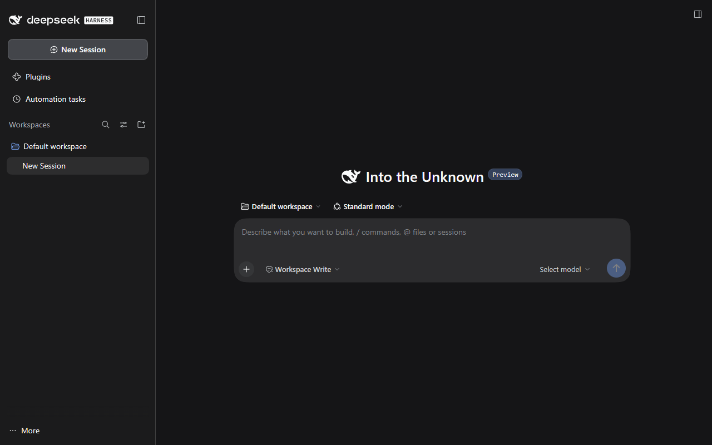
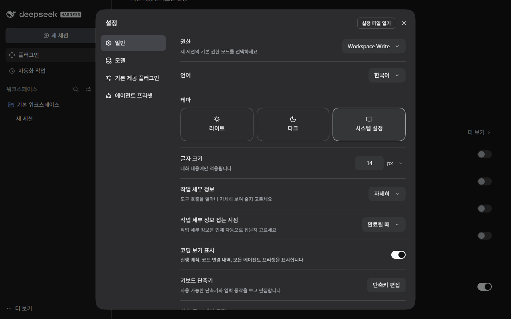
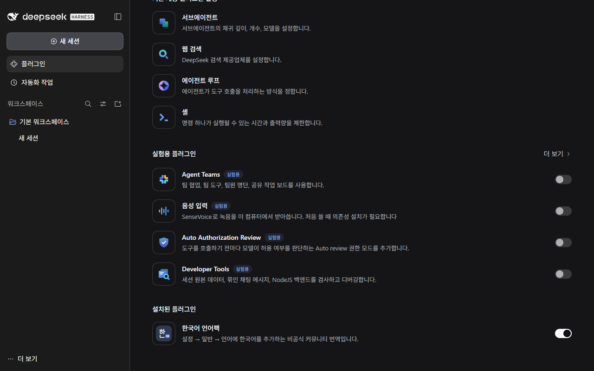

# dsh-locale-ko

**한국어** | [English](README.en.md)

**DeepSeek Harness(DSH) 비공식 한국어 언어팩** · 딥시크 하네스 한글 패치

> **Korean (한국어) UI language pack for [DeepSeek Harness](https://www.deepseek.com/en/harness/).**
> Install it from **Plugins → Add plugin** with `https://github.com/jjoni12/dsh-locale-ko`, then pick 한국어 in Settings → General → Language.
> Unofficial community translation; not affiliated with or endorsed by DeepSeek.

DeepSeek Harness의 화면(채팅, 사이드바, 설정, 플러그인, 자동화 작업, 파일 미리보기, 대화상자 등)을 한국어로 바꿔 주는 플러그인입니다.
앱 프로그램 파일은 건드리지 않고 DSH 플러그인으로만 설치되기 때문에, 플러그인 화면에서 언제든 끄거나 제거할 수 있습니다.

| 적용 전 | 적용 후 |
|---|---|
|  |  |

<details>
<summary>스크린샷 더 보기 (설정, 플러그인 화면)</summary>





</details>

## 기준 앱

이 언어팩은 DeepSeek의 [DeepSeek Harness 공식 페이지](https://www.deepseek.com/en/harness/)에서 배포하는 **공식 데스크톱 앱**(Download for Windows)을 기준으로 만들었습니다. 같은 페이지에서 안내하는 `npx @deepseek-ai/dsh web`(Web UI)에서도 동작합니다.

이 프로젝트는 비공식 커뮤니티 번역이며, DeepSeek가 만들거나 보증한 것이 아닙니다.

## 지원 버전

| 앱 | 버전 |
|---|---|
| [DeepSeek Harness 공식 데스크톱 앱](https://www.deepseek.com/en/harness/) (Windows 64-bit) | 0.2.1-rc.2 |
| `npx @deepseek-ai/dsh web` (Web UI) | 0.2.1-rc.2 |

다른 버전에서는 일부 문구가 영어로 나오거나 동작하지 않을 수 있습니다.

## 설치

Node.js나 터미널은 필요 없습니다.

1. DeepSeek Harness 왼쪽 사이드바에서 **플러그인**을 엽니다.
2. 오른쪽 위 **플러그인 추가**를 누르고, 아래 주소를 입력한 뒤 **설치**를 누릅니다.

   ```
   https://github.com/jjoni12/dsh-locale-ko
   ```

3. 설치가 끝나면 **지금 켜기**를 누릅니다. 다시 시작하지 않아도 바로 적용됩니다.

설정 → 일반 → 언어에서 `한국어`를 고를 수 있습니다. 운영체제 언어가 한국어이고 따로 고른 언어가 없으면 자동으로 한국어가 선택됩니다.

### 끄기 / 제거 / 업데이트

- **끄기**: 플러그인 → 설치된 플러그인 → 한국어 언어팩의 스위치를 끕니다.
- **제거**: 한국어 언어팩을 눌러 상세 화면에서 **제거**를 누릅니다.
- **업데이트**: 제거한 뒤 같은 주소로 다시 설치합니다.

설치, 끄기, 제거는 모두 DSH 앱의 **플러그인 화면**에서 처리되며, 언어팩은 **내 설정 파일**(`cordis.patch.yml`)을 직접 수정하지 않습니다.

## 구성

| 파일 | 역할 |
|---|---|
| `package.json` | DSH 플러그인 선언 (번들 + 클라이언트 플러그인) |
| `cordis.patch.yml` | 번들을 켜면 언어팩 플러그인을 불러오는 설정 |
| `lib/client.js` | 빌드된 언어팩 본체 |
| `locale/*.json` | 플러그인 화면에 표시되는 이름과 설명 (영어·중국어·한국어) |
| `icon.svg` | 플러그인 아이콘 |
| `src/ko-dict.json` | 앱 번역 시스템에 등록된 문구의 한국어 번역 (0.2.1 기준 56개 네임스페이스, 2,566개 키) |
| `src/ko-static.json` | 번역 시스템을 거치지 않는 문구의 한국어 번역. `global`(어디서나), `plugins`(플러그인 화면 안에서만) 두 묶음 |
| `src/client.template.js`, `src/build.mjs` | 위 파일들로 `lib/client.js`를 만드는 템플릿과 빌드 스크립트 |

## 번역 수정하기

`src/ko-dict.json` 또는 `src/ko-static.json`을 고친 뒤 빌드하세요.

```bash
node src/build.mjs
```

오역이나 빠진 문구는 Issue나 Pull Request로 알려 주세요.

## 동작 방식

- DSH가 제공하는 언어팩 API로 `ko` 언어(대체 언어 `en`)를 추가하고, 네임스페이스별 한국어 사전을 등록합니다. 언어 선택은 DSH가 직접 설정에 저장합니다.
- 번역 시스템을 거치지 않는 일부 문구는, 화면에 표시된 텍스트가 정확히 일치할 때만 한국어로 바꿉니다. 다른 언어로 바꾸면 즉시 원래 문구로 돌아갑니다.
  - 플러그인 이름·설명은 플러그인 화면 안에서만 바꿉니다.
  - "Status", "Tools" 같은 짧은 단어는 바꾸지 않습니다. 같은 이름의 파일·폴더·세션 제목이 잘못 바뀌지 않도록 하기 위해서입니다.
  - 대화 본문(AI 답변, 사용자 메시지, 추론 내용, 코드)은 바꾸지 않습니다.

## 한계

- 앱 자체에 내장된 화면은 번역할 수 없습니다. 공식 데스크톱 앱의 창 메뉴(Application, Edit 등)가 여기에 해당합니다.
- 설정 → 기본 제공 플러그인 목록의 패키지 설명은 각 패키지의 개발자용 설명이라 공식 중국어판에서도 영어로 나오며, 이 언어팩도 번역하지 않습니다.
- 외부 플러그인과 서버에서 내려오는 일부 문구(도구 이름, 오류 원문 등)는 영어로 남을 수 있습니다.
- 앱이 업데이트되면 새 문구가 영어로 나올 수 있습니다.

## 라이선스

[MIT](LICENSE)

번역의 원문은 MIT 라이선스로 배포되는 [DeepSeek Harness](https://github.com/deepseek-ai/deepseek-harness)(Copyright (c) 2026 DeepSeek)의 UI 문구입니다. 자세한 내용은 [NOTICE](NOTICE)를 보세요.
